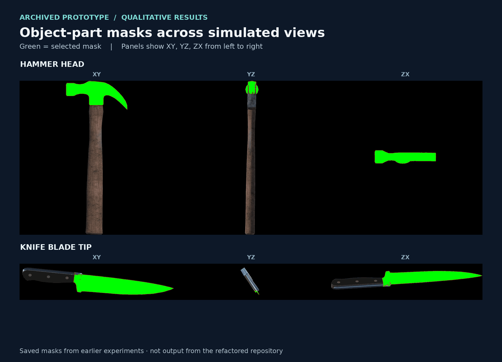
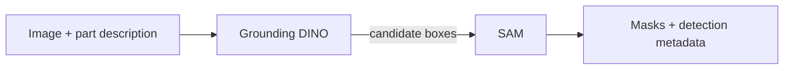
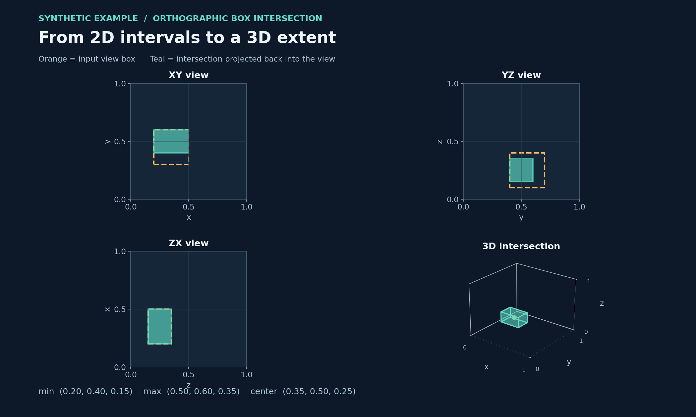

# Object-Part Grounding for Robotics

**From a language description to a candidate object part, and from multiple views to an approximate 3D extent.**

Robotic interaction often depends on *which part* of an object is relevant: a hammer's head, a mug's handle, or a knife's blade. This project explores how pretrained vision models and simple multiview geometry can connect part descriptions to spatial representations.

`Computer vision` · `Grounding DINO` · `SAM` · `Multiview geometry` · `Robotics`



*Qualitative outputs saved by an earlier prototype in simulated orthographic views. Green indicates the selected mask. These images are from the archive, not runs of the refactored repository; empty black margins were cropped in the knife example.*

## What the examples show

The hammer example highlights a candidate head region across three views. The knife example shows why inspection matters: the mask labeled **blade tip** covers much of the blade in two views and only a small area in another. These examples illustrate the approach and its limitations; they are not ground truth or a benchmark.

The earlier experiments combined text-conditioned detection and segmentation, with an additional mask-selection step. The implementation in this repository provides the detector/segmenter and a separate box-intersection utility; it does not reproduce that entire experimental pipeline automatically. [See the project overview](https://artin-saberpour.github.io/projects/object-part-grounding/).

## How it works

### 1. Text-guided 2D grounding



Grounding DINO proposes boxes for a text query such as `hammer head`; SAM uses those boxes to generate masks. The command saves an overlay, binary masks, and a JSON file with labels, scores, and pixel coordinates.

### 2. Approximate 3D geometry

The geometry utility intersects manually supplied 2D boxes from axis-aligned orthographic views within known 3D object bounds. In the example below, orange outlines are the input boxes and teal shows the intersection projected into each view.



*The 2D boxes and bounds are synthetic inputs to `partground intersect`; they are not detections, predictions, or measured 3D accuracy. The normalized output is generated by the included geometry code.*

The commands are **separate**. The current code does not associate detections across views or automatically pass predicted boxes into the geometry utility.

## Run the examples

Python 3.10 or 3.11 is recommended. The geometry demo only needs NumPy and Pillow.

```powershell
py -3.11 -m venv .venv
.\.venv\Scripts\Activate.ps1
python -m pip install --upgrade pip
python -m pip install -e .
partground intersect examples\orthographic_boxes.json
python -m unittest discover -s tests -v
```

On macOS or Linux, activate with `source .venv/bin/activate` and use `examples/orthographic_boxes.json`.

For the included synthetic boxes and unit bounds, the utility returns:

```json
{
  "bbox_min": [0.2, 0.4, 0.15],
  "bbox_max": [0.5, 0.6, 0.35],
  "center": [0.35, 0.5, 0.25]
}
```

### Run the model pipeline

Install the appropriate CUDA-enabled PyTorch and torchvision builds using the [official PyTorch selector](https://pytorch.org/get-started/locally/), then install the optional dependencies:

```powershell
python -m pip install -e ".[models]"
partground ground --image path\to\image.jpg --text "hammer head" --output outputs\hammer --device cuda
```

Omit `--device` for automatic selection, or use `--device cpu`. The detector threshold defaults to `0.3` and can be changed with `--threshold`. The first run downloads model weights from Hugging Face. Outputs are written to the chosen directory as `overlay.png`, `mask_000.png` and `detections.json`. If no boxes are detected, the JSON list is empty.

## Scope and validation

- **What has been checked:** synthetic geometry, box handling, and output writing using a fake detector/segmenter are covered by the included tests.
- **What remains to be checked:** the refactored real-model pipeline has not been run end to end here; detection quality and 3D accuracy have not been measured.
- **Geometry assumptions:** images must correspond to known, axis-aligned orthographic views whose full axes map linearly to the supplied 3D bounds. Incorrect axes, crop, padding, perspective, or inconsistent views break this approximation. The output is an axis-aligned box, not a 3D segmentation.
- **Research context:** this is an AI-assisted reconstruction and refactoring of exploratory scripts. It is separate from the final method of the associated paper. Related CLIP, YOLO, and orientation experiments are not part of this repository.

## Models and acknowledgments

This project uses pretrained third-party components: [Grounding DINO](https://github.com/IDEA-Research/GroundingDINO) via [`IDEA-Research/grounding-dino-tiny`](https://huggingface.co/IDEA-Research/grounding-dino-tiny), and [Segment Anything](https://github.com/facebookresearch/segment-anything) via [`facebook/sam-vit-base`](https://huggingface.co/facebook/sam-vit-base). Model interfaces use [Hugging Face Transformers](https://huggingface.co/docs/transformers/). Review upstream code, model, and data licenses before reuse.
