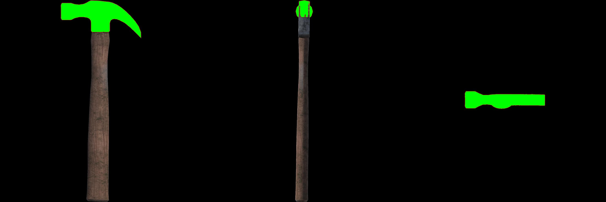
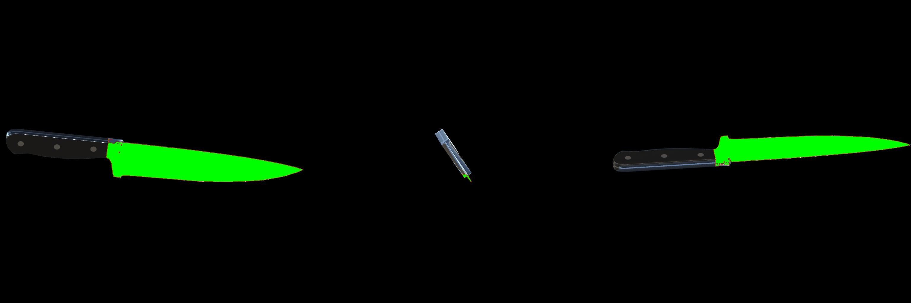
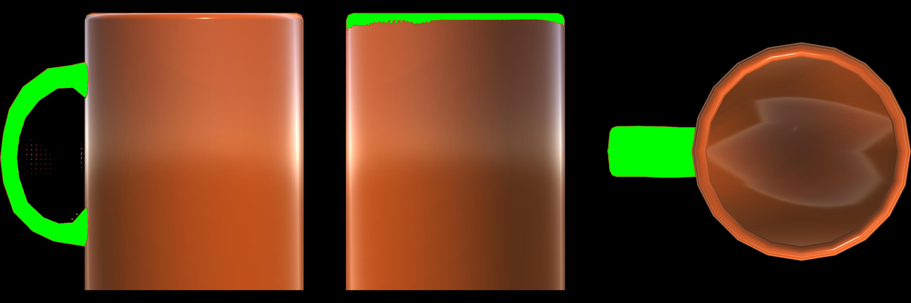

# Object-Part Grounding for Robotics

**From a language description to a candidate object part, and from multiple views to an approximate 3D extent.**

Robotic interaction often depends on *which part* of an object is relevant: a hammer's head, a mug's handle, or a knife's blade. This project explores how pretrained vision models and simple multiview geometry can connect part descriptions to spatial representations.

`Computer vision` · `Grounding DINO` · `SAM` · `Multiview geometry` · `Robotics`

## Archived qualitative examples

These are the original saved visualization files from the exploratory project archive, shown without added framing or alterations. They show selected masks in three simulated views, ordered XY, YZ and ZX. Green marks a selected region.

**Hammer head**



**Knife blade tip**



**Mug handle**



These are qualitative examples, not ground truth. They also expose limitations: the knife mask labeled *blade tip* covers much of the blade in two views, and the mug mask includes other regions in some views.

The original scripts save images with these filenames after text-guided detection, segmentation, and mask selection. Exact run settings and logs for the saved images were not found, so their complete provenance cannot be independently reconstructed. These files predate the refactored repository and were not generated by running its current code. [See the project overview](https://artin-saberpour.github.io/projects/object-part-grounding/).

## How it works

### 1. Text-guided 2D grounding

**Image and part description → Grounding DINO → SAM → masks and detection metadata**

Grounding DINO proposes boxes for a text query such as `hammer head`; SAM uses those boxes to generate masks. The command saves an overlay, binary masks, and a JSON file with labels, scores, and pixel coordinates.

### 2. Approximate 3D geometry

The geometry utility intersects manually supplied 2D boxes from axis-aligned orthographic views within known 3D object bounds. The archived mask images above show part localization, but the archive does not contain a verified corresponding 3D result for those particular images.

The commands are **separate**. The current code does not associate detections across views or automatically pass predicted boxes into the geometry utility.

## Run the examples

Python 3.10 or 3.11 is recommended. The geometry demo only needs NumPy and Pillow.

```powershell
py -3.11 -m venv .venv
.\.venv\Scripts\Activate.ps1
python -m pip install --upgrade pip
python -m pip install -e .
partground intersect examples\orthographic_boxes.json
python -m unittest discover -s tests -v
```

On macOS or Linux, activate with `source .venv/bin/activate` and use `examples/orthographic_boxes.json`.

For the included synthetic boxes and unit bounds, the utility returns:

```json
{
  "bbox_min": [0.2, 0.4, 0.15],
  "bbox_max": [0.5, 0.6, 0.35],
  "center": [0.35, 0.5, 0.25]
}
```

### Run the model pipeline

Install the appropriate CUDA-enabled PyTorch and torchvision builds using the [official PyTorch selector](https://pytorch.org/get-started/locally/), then install the optional dependencies:

```powershell
python -m pip install -e ".[models]"
partground ground --image path\to\image.jpg --text "hammer head" --output outputs\hammer --device cuda
```

Omit `--device` for automatic selection, or use `--device cpu`. The detector threshold defaults to `0.3` and can be changed with `--threshold`. The first run downloads model weights from Hugging Face. Outputs are written to the chosen directory as `overlay.png`, `mask_000.png` and `detections.json`. If no boxes are detected, the JSON list is empty.

## Scope and validation

- **What has been checked:** synthetic geometry, box handling, and output writing using a fake detector/segmenter are covered by the included tests.
- **What remains to be checked:** the refactored real-model pipeline has not been run end to end here; detection quality and 3D accuracy have not been measured.
- **Geometry assumptions:** images must correspond to known, axis-aligned orthographic views whose full axes map linearly to the supplied 3D bounds. Incorrect axes, crop, padding, perspective, or inconsistent views break this approximation. The output is an axis-aligned box, not a 3D segmentation.
- **Research context:** this is an AI-assisted reconstruction and refactoring of exploratory scripts. It is separate from the final method of the associated paper. Related CLIP, YOLO, and orientation experiments are not part of this repository.

## Models and acknowledgments

This project uses pretrained third-party components: [Grounding DINO](https://github.com/IDEA-Research/GroundingDINO) via [`IDEA-Research/grounding-dino-tiny`](https://huggingface.co/IDEA-Research/grounding-dino-tiny), and [Segment Anything](https://github.com/facebookresearch/segment-anything) via [`facebook/sam-vit-base`](https://huggingface.co/facebook/sam-vit-base). Model interfaces use [Hugging Face Transformers](https://huggingface.co/docs/transformers/). Review upstream code, model, and data licenses before reuse.
